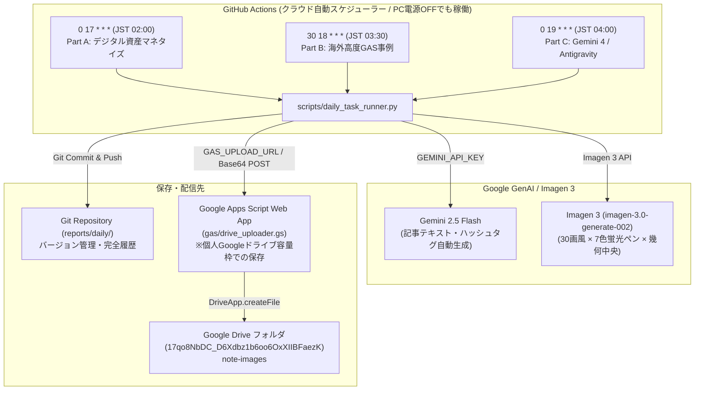

# 日次リサーチ＆アイキャッチ自動生成 GitHub Actions パイプライン 引き継ぎ書（HANDOFF.md）

本ドキュメントは、PCの電源が落ちていてもクラウド（GitHub Actions）上で24時間365日自動実行される「日次リサーチレポート（Part A, Part B, Part C）生成」「アイキャッチ画像生成（30画風×7色蛍光サインペン×完全幾何中央）」「Google ドライブへの自動保存」パイプラインの引き継ぎ仕様書です。

参照元アーキテクチャ: [DEV Community: Refactoring LINE Business Card Assistant with Antigravity Remote Agent (Option A: Remote Agent + GitHub Handoff)](https://dev.to/gde/ai-hands-on-refactoring-line-business-card-assistant-python-to-go-with-antigravity-remote-agent-2db9)

---

## 1. システム全体アーキテクチャ



---

## 2. 定時実行スケジュール（JST / UTC）

| パート | 調査対象テーマ | JST実行時刻 | GitHub Actions Cron式 (UTC) | 保存ファイル名 |
| :--- | :--- | :--- | :--- | :--- |
| **Part A** | デジタルスキル・資産マネタイズ調査 | 毎日 02:00 | `0 17 * * *` | `YYYY-MM-DD-part_a.md`<br>`YYYY-MM-DD#本日のデジタル資産・スキルのマネタイズ.png` |
| **Part B** | 海外の高度GAS活用事例調査 | 毎日 03:30 | `30 18 * * *` | `YYYY-MM-DD-part_b.md`<br>`YYYY-MM-DD#本日の高度GAS.png` |
| **Part C** | Gemini 4 / Antigravity / AI Studio | 毎日 04:00 | `0 19 * * *` | `YYYY-MM-DD-part_c.md`<br>`YYYY-MM-DD#本日の生成AIニュース.png` |

---

## 3. レポート＆アイキャッチの厳格準拠ルール

1. **アイキャッチ配置の鉄則**:
   - サインペン文字は**画像の幾何学的完全中央（Dead Center: X=50%, Y=50%）**に配置（下部・上部配置は完全禁止）。
   - 30種類の多様な画風・画材（`STYLES_30`）からランダム選定。
   - 7色の蛍光サインペン（ピンク、シルバー、ゴールド、イエロー、グリーン、ホワイト、パープル）からランダム選定。
   - 流れるような達筆の筆使い、インクの自然な滲み・かすれ・濃淡、文字輪郭に密着するダークドロップシャドウを生成プロンプトで直接制御。
2. **記事構成・ハッシュタグ規程**:
   - 記事内の「`3. note用ハッシュタグ（12個）`」のような見出し行は完全廃止。
   - 記事末尾に直接プレーンテキストコードブロック（```` ```text ... ``` ````）形式で12個のタグを配置。
   - パートCの最終行は必ず `早く2月にならないかな・・・` で終了。

---

## 4. Google ドライブ保存とクォータ制限回避（GAS Web App）

### 背景と重要知見
Google Drive API の仕様上、個人 Google アカウント（`@gmail.com`）の通常フォルダに対してサービスアカウント（GCP Service Account）からファイルをアップロードすると、サービスアカウント側のストレージ枠（0MB）が適用され、`storageQuotaExceeded`（エラーコード403）が発生します。

### 解決策（GAS Web App 連携）
リポジトリ内の [`gas/drive_uploader.gs`](file:///home/antigravity/netch-git/wp-auto-post/gas/drive_uploader.gs) を Google Apps Script のウェブアプリとしてデプロイすることで、ユーザー個人のGoogleドライブ容量枠を使用してファイルを自動保存できます。

#### デプロイ手順（3分）
1. [Google Apps Script 新規プロジェクト](https://script.google.com/) を開く。
2. [`gas/drive_uploader.gs`](file:///home/antigravity/netch-git/wp-auto-post/gas/drive_uploader.gs) の内容を貼り付けて保存。
3. 画面右上の **「デプロイ」 > 「新しいデプロイ」** を選択：
   - 種類: **ウェブアプリ**
   - 次のユーザーとして実行: **自分**
   - アクセスできるユーザー: **全員（Anyone）**
4. デプロイ完了時に表示される「ウェブアプリのURL」をコピー。
5. GitHub リポジトリ（`wp-auto-post`）の Secrets に `GAS_UPLOAD_URL` として登録。

---

## 5. GitHub Secrets 設定状況

| Secret名 | 状態 | 用途 |
| :--- | :--- | :--- |
| `GEMINI_API_KEY` | **設定済み** | Gemini 2.5 Flash（記事作成）および Imagen 3（画像生成） |
| `GCP_SA_KEY` | **設定済み** | Google Cloud サービスアカウントキー |
| `GAS_UPLOAD_URL` | **任意設定** | GAS Web App経由で個人Drive容量枠へアップロードするURL |
| `GAS_UPLOAD_TOKEN` | 任意設定 | GAS Web Appアクセス用のトークン（省略時は未検証） |

---

## 6. 即時検証コマンド

### GitHub Actions ワークフローの手動実行
```bash
# 全パート (A, B, C) 一括テスト
gh workflow run daily_research_pipeline.yml -R netch-git/wp-auto-post -f part=ALL

# パートAのみテスト
gh workflow run daily_research_pipeline.yml -R netch-git/wp-auto-post -f part=A

# 実行ログの監視
gh run watch -R netch-git/wp-auto-post
```

### ローカルまたはCLIでの単体実行テスト
```bash
# パートAのテキストのみテスト
python scripts/daily_task_runner.py --part A --skip-image --skip-upload

# パートCのフル実行
python scripts/daily_task_runner.py --part C
```
