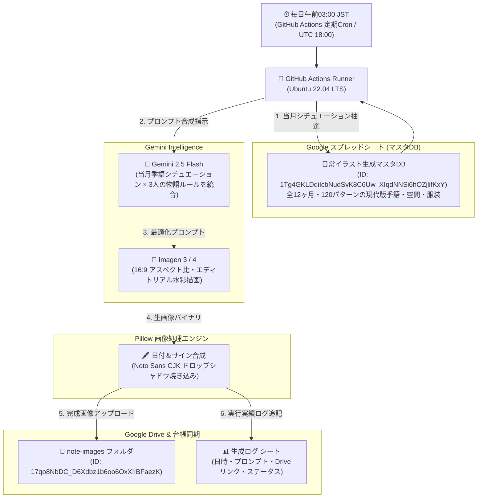

# Daily Editorial Illustration Pipeline
## note記事アイキャッチ自律生成システム（3人の女子生徒・12ヶ月日常編）

- **最終更新日**: 2026年11月15日 (日)
- **運用環境**: GitHub Actions (`netch-git/wp-auto-post`) × Google Cloud Vertex AI / AI Studio × Google Workspace (Sheets / Drive)
- **定期実行**: 毎日 **午前 03:00 JST**（UTC 18:00）完全自動実行（PC電源オフ対応）

---

## 📖 1. プロジェクト概要

本プロジェクトは、日々のnote記事（デジタル資産マネタイズ・高度GAS事例・AIニュース等）に添えるアイキャッチ画像を、**「プロンプト入力の手間ゼロ」「画風のブレゼロ」「意図しない課金ゼロ」**で自律生成し、Google Driveおよびスプレッドシート管理台帳へ毎朝自動集約するシステムです。

3人の女子生徒の日常を1年を通じて追う物語構成を採用し、日本の商業アートブックやエディトリアルイラストレーションに匹敵する「手描き水彩・ペン画」の高品質な世界観を維持し続けます。



---

## 🎨 2. 画風およびキャラクター継続性ガイドライン

### 【画風・画材の絶対ルール（Non-Negotiable）】
- **ジャンル**: 現代日本の商業アートブック・書籍装画・エディトリアルイラストレーション。
- **描画媒体**: 均一で繊細なミリペン・細線インク輪郭（ligne claire）、冷圧紙（cold-press paper）の微細な紙目テクスチャ、マットな不透明ガッシュおよび透明水彩の重層滲み。
- **色彩設計**: 落ち着いたアースカラー・環境光の調和。イルミネーション、花火、シャボン玉など生命感を高める焦点要素にのみ厳選された鮮やかさを許可。
- **厳格禁止事項**:
  - 安っぽいCG光沢、プラスチック質感、3Dデジタルグラデーションの完全禁止。
  - アニメ的萌え表現（過剰に大きな瞳、大口を開けた笑顔、頬の赤み・赤面線）の完全禁止。
  - 看板・背景・衣類など画面内へのあらゆる文字（疑似グリフ含む）の混入禁止。
- **空間・構図**: 人物が過剰に画面を占有しない、引き気味の建築的パースペクティブ（画面高の40%以下）。足元や通路のクリアランスを確保。

### 【3人の登場人物（1年間の物語継続性）】
季節や天候に応じた服装調整（半袖・カーディガン・マフラー等）を行いながら、以下の3名のアイデンティティを一貫して維持します：
1. **少女 1（画面左または中央）**:
   - 清楚な黒髪ショートボブカット。端正なネイビーブレザー制服。足元にネイビーのダッフルバッグ。物静かで観察眼のある落ち着いた佇まい。
2. **少女 2（中央またはリラックス位置）**:
   - ゆるいウェーブのかかった栗色ポニーテール。制服の上に羽織ったオーバーサイズのベージュカーディガン。自然なコントラポスト（重心を片足にかけた脱力姿勢）。
3. **少女 3（画面右または友人を見る位置）**:
   - スポーティなレイヤーショートの黒髪。ブレザーや上着のポケットに両手を入れ、肩にキャンバストートバッグをかけた快活で自然な立ち居振る舞い。
- **表情・連携**: 3人が同じ空気感を共有する、口を結んだ控えめで自然なマイクロエクスプレッション（1人が泣いているのに2人が笑うような不自然な組み合わせを排除）。

---

## 📊 3. 連携リソースおよびデータベース仕様

| リソース | 名称 / 参照先 | 役割 |
| :--- | :--- | :--- |
| **スプレッドシート（マスタ）** | [日常イラスト生成マスタDB（12ヶ月季語・空間・服装）](https://docs.google.com/spreadsheets/d/1Tg4GKLDqiIcbNudSvK8C6Uw_XIqdNNSi6hOZjlifKxY/edit) | 120行（各月10パターン）の現代版季語、ロケーション、服装指定、構図シード。 |
| **スプレッドシート（ログ）** | 同上 スプレッドシート内 `生成ログ` タブ | 毎朝の実行日時、対象月、季語、プロンプト全文、Google Driveリンク、成否ステータスを永続記録。 |
| **Google Drive保管庫** | `G:\マイドライブ\antigravity\Notebook\wordpress\note-images`<br/>(Folder ID: `17qo8NbDC_D6Xdbz1b6oo6OxXIIBFaezK`) | 完成画像（PNG）の集約フォルダ。既存のnote連載画像と完全一本化。 |
| **GCP サービスアカウント** | `gemini-runner@gemini-ai-lab-20261024.iam.gserviceaccount.com` | Sheets API および Drive API の書き込み権限（`writer`）を付与済み。 |

---

## ⚙️ 4. ディレクトリ構成

```text
netch-git/wp-auto-post/
├── .github/
│   └── workflows/
│       ├── daily_illust.yml              <-- 【本システム】毎朝03:00 JST自動実行ワークフロー
│       ├── daily_research_pipeline.yml   <-- （休止中）旧リサーチワークフロー
│       └── auto_post.yml                 <-- （休止中）WordPress投稿ワークフロー
├── daily_illust_main.py                  <-- 【本システム】生成・合成・Driveアップロード本体
├── requirements.txt                      <-- Python依存ライブラリ（google-genai, pillow等）
├── README.md                             <-- 本ドキュメント (2026-11-15 改訂)
└── HANDOFF.md                            <-- 過去の引き継ぎメモ
```

---

## 🔐 5. 必要な GitHub Secrets 設定

リポジトリの `Settings` → `Secrets and variables` → `Actions` に登録されている環境変数：

| シークレット名 | 必須 / 任意 | 説明 |
| :--- | :---: | :--- |
| **`GCP_SA_KEY`** | **必須** | `gemini-ai-lab-key.json` のJSON全文（Sheets/Drive書き込み権限を持つサービスアカウント鍵） |
| **`GEMINI_API_KEY`** | **必須** | Google AI Studio の API キー（プロンプト生成および Imagen 呼び出し用） |
| **`SPREADSHEET_ID`** | 任意 | マスタDBのシートID（コード内にデフォルト値 `1Tg4GKLDqiIcbNudSvK8C6Uw_XIqdNNSi6hOZjlifKxY` を内蔵） |
| **`DRIVE_FOLDER_ID`** | 任意 | 画像保存先のDriveフォルダID（コード内にデフォルト値 `17qo8NbDC_D6Xdbz1b6oo6OxXIIBFaezK` を内蔵） |

---

## 🚀 6. 手動テストおよび運用手順

### GitHub Web画面からの即時手動実行
明朝3時を待たずにテスト実行を行いたい場合：
1. ブラウザで [Actions - Daily Illustration Pipeline](https://github.com/netch-git/wp-auto-post/actions/workflows/daily_illust.yml) を開く。
2. 右上の **「Run workflow」** ドロップダウンをクリックし、緑色の **「Run workflow」** ボタンを押す。
3. 実行完了後、Google Driveの `note-images` フォルダおよびスプレッドシートの「生成ログ」に結果が反映されます。

### ローカル（PC）での手動実行
```powershell
cd C:\Users\kynet\wp-auto-post
python daily_illust_main.py
```
*(※ローカル実行時は環境変数または `gemini-ai-lab-key.json` の配置を参照して自動動作します)*

---

## 🏆 7. 改訂履歴
- **2026-11-15**:
  - `wp-auto-post` リポジトリを再活用し、日常イラスト自律生成パイプラインへ完全統合。
  - 定期実行スケジュールを午前03:00 JST（`0 18 * * *` UTC）に正式設定。
  - 12ヶ月×120種季語スプレッドシートDBおよびGoogle Drive `note-images` フォルダとの双方向連携を確立。
  - Google AI Challenge（25周年）提出用の構成・スライド資料との同期完了。
