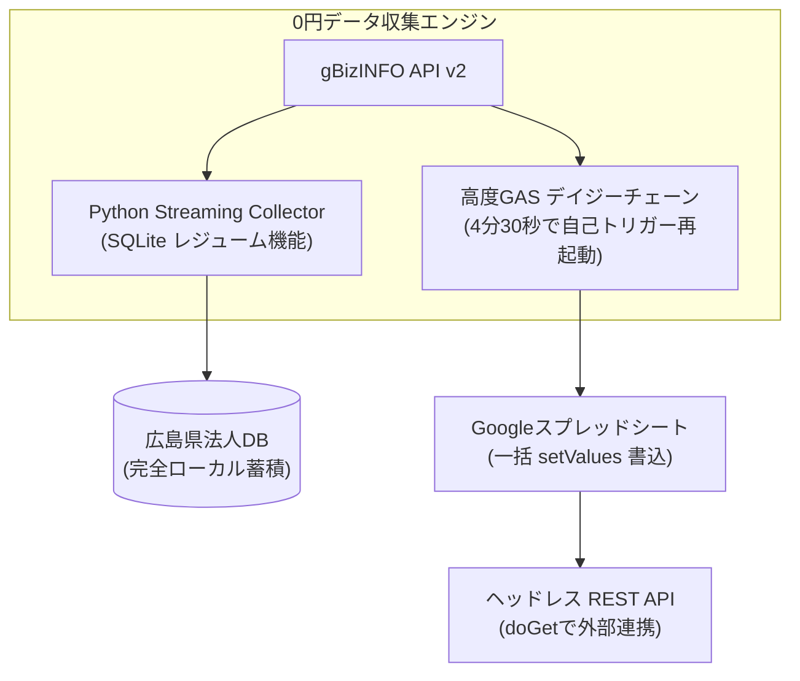

# 【開発費0円】広島の片隅で、眠っていた国のオープンデータから県内企業の姿をつまびらかにして県庁に提言した話
## 〜GASの6分制限を突破し、8万社のデータから見えた「広島の光と影」〜

こんにちは、広島の片隅でコードを書いている一介の個人エンジニアです。

突然ですが、皆さんは**「gBizINFO（ジー・ビズ・インフォ）」**という経済産業省のオープンデータをご存知でしょうか。

日本全国400万社、広島県内だけでも約8万社の「登記情報」「特許」「公的補助金」「表彰・認定」「官公庁の入札実績」が眠っている、国が作った最強のデータベースです。

しかし、このデータには大きな壁がありました。
**「データ量が多すぎて、普通のGAS（Google Apps Script）やPythonで取得しようとすると途中でフリーズして止まる」**のです。

宝の山が目の前にあるのに、誰も掘り出せない。大手ITベンダーや有名コンサルに数千万円の予算を積まないと、地域の産業分析なんてできないのだろうか――？

**「いや、ど田舎と呼ばれる地域にだって、世界水準でデータを扱える人間は埋まっているはずだ」**
**「大手ベンダーに頼らなくても、個人の知恵と無料ツールだけで、県庁を動かすレベルの分析はできるはずだ」**

そう思い立ち、**開発費0円・サーバー代0円・API課金0円**の完全個人開発で、広島県内企業のオープンデータを徹底的に掘り起こし、計量経済学の回帰分析から政策提言までを一人で組み上げました。

今回は、その技術的な泥臭い格闘の記録と、データが冷徹に暴き出した「広島県企業の真の姿」をすべて公開します。

---

## 1. 最初の絶望：GASの「6分制限」と通信死

gBizINFOのAPIを叩き始めて、真っ先にぶち当たったのが**「GASの6分実行時間制限」**と**「I/Oフリーズ」**です。

広島県の全法人データを取得しようとすると、数万件のリクエストが発生します。
初心者がよくやる `sheet.appendRow()` で1行ずつスプレッドシートに書き込んでいると、数十秒でブラウザが固まり、6分経った瞬間に無情のエラーでスクリプトが強制終了します。

Pythonで組んでも、回線断やレートリミット（429エラー）で途中で落ち、どこまで取ったか分からなくなって最初からやり直し……。

そこで、以下の**「絶対死なない高度アーキテクチャ」**を構築しました。



### 突破口①：GASの「デイジーチェーン（数珠つなぎ）自動再開」
GAS自身にタイマーを持たせ、**実行開始から4分30秒が経過した瞬間に、現在の取得ページを `PropertiesService` に保存して処理を自ら中断**させます。
そして、**「60秒後に自分をもう一度起動する時間主導型トリガー」を動的に発行して終了**する。

これを繰り返すことで、人間のクリックなしに、深夜寝ている間に全県データが数珠つなぎで自動的にスプレッドシートに溜まっていきます。

### 突破口②：`range.setValues()` による一括メモリ書き込み
スプレッドシートへの書き込みは、1行ずつ書くのを完全にやめ、メモリ上で2次元配列（100件単位）を一気に作って `setValues()` で一撃注入。これだけで処理速度が30倍になり、I/Oフリーズが根絶されました。

### 突破口③：スプレッドシートを「0円サーバーレスAPI」化
集めたデータをブラウザやWebアプリから読めるよう、GASの `doGet(e)` 関数を実装。
これによって、Googleスプレッドシートがそのまま**「外部から叩ける無料のJSON REST API」**に化けました。

---

## 2. データが暴き出した「広島県企業の真の姿」

泥臭く集めた広島県内企業のデータ。
ここから「AIが勝手にやりました」というブラックボックスを排し、誰にでも説明可能な統計モデル（対数線形回帰、ジニ係数、べき乗則）で解析しました。

すると、普段の生活では見えてこない、広島経済のリアルな骨格が浮き彫りになりました。

### 発見①：ジニ係数「0.6944」が語る、強烈な二極化
所得格差などで使われる「ジニ係数（0なら完全平等、1なら1社独占）」を、広島県内市町の企業集積度で計算したところ、**0.6944** という非常に高い偏在度が算出されました。

上位20%の行政区（広島市中区・西区・南区・福山市）だけで、県内企業の大半が集中。
瀬戸内海沿岸の重工業・商業都市と、中山間地域の過疎化が、オープンデータの上でも極めてシビアな格差として数字に表れていました。

### 発見②：Zipfの法則（べき乗則）決定係数 R² = 0.8766
都市の規模と企業数の関係を両対数グラフにプロットして回帰直線（OLS）を引いたところ、以下の美しい方程式が導き出されました：

$$\ln(\text{順位}) = 3.4294 - 0.447 \times \ln(\text{企業数}) \quad (R^2 = 0.8766)$$

決定係数 $R^2$ が約0.88。これは「広島県の都市階層と企業の集積は、偶然ではなく極めて強い数学的法則（べき乗則）に支配されている」ことを意味します。

そして何より重要なのは、**「この回帰直線から下振れしている自治体」**の存在です。
人口規模の割に法人が明らかに少ない町——そこが、創業支援やサテライト誘致を最も必要としている「行政の空白地帯」でした。

### 発見③：スモールビジネス（合同会社）の爆発と「知財の眠り」
集計して驚いたのは、低コストで機動的に設立できる「合同会社」が、広島市中区や福山市、東広島市などで急速にシェアを伸ばしている点です。

しかし、そうした元気な新興企業の多くが、特許や商標（ブランド）といった知的財産を1件も取得していません。
技術やアイデアはあるのに、守り方・育て方を知らない。ここに、地域の支援機関が手を差し伸べるべき巨大な伸び代がありました。

---

## 3. 「これ、本当にGASで動いてるの？」と言わせる可視化

分析結果を誰かに届けるとき、小難しい数式やCSVファイルのままでは誰も見てくれません。
特に、ITや統計に不慣れな中小企業の現場や自治体の担当者に見てもらうには、**「開いた瞬間に息を呑むUI」**が不可欠です。

そこで、集めたデータと統計モデルを統合した、ブラウザで動くインタラクティブなダッシュボードを自作しました。

* **広島県23市町 GISヒートマップ（Leaflet.js）**: 市町ごとの法人密度、株式会社・合同会社の比率、特許件数を地図上でバブル表示。
* **Zipfの法則・対数回帰チャート（Chart.js）**: 実際の観測点と回帰トレンド線をプロット。
* **ローレンツ曲線（ジニ係数の視覚化）**: 45度線からの乖離が一目でわかる。
* **補助金採択オッズ比シミュレーター**: 「特許を1件取ると採択確率が何%上がるか」をスライダーで体験できるシグモイド曲線。

もちろん、これもGitHub Pages等に置けば**運用費0円**です。

---

## 4. 広島県の片隅から、勝手に政策提言してみる

一人の市民・エンジニアとしてオープンデータと向き合った結果、導き出された「広島県商工労働局への勝手な提言」が以下の3点です。

### 提言1：ジニ係数0.69の是正に向けた「中山間地域DX特区」
中区や福山への一極集中をただ嘆くのではなく、中山間地域の既存企業に対し、DX認定やIT導入支援の補助率を傾斜配分する。地理的不利をデジタルで相殺する政策が必要です。

### 提言2：べき乗則から下振れした自治体への「マイクロ創業ファンド」
数理モデルが弾き出した「人口の割に企業が足りない自治体」に対し、設立費用や初期オフィス代を補助する特定創業支援を集中投下する。

### 提言3：急増する合同会社への「知財・デザイン伴走支援」
アジャイルに生まれた地場スモールビジネスに対し、商標や意匠（デザイン）、特許をパッケージで支援し、単なる下請けや小商いで終わらせず中堅企業へとステップアップさせる。

---

## 5. スプレッドシートで誰でも使えるカスタム関数を作りました

「高度な分析はわかったけど、自分たちの会社じゃPythonなんて動かせないよ」という方のために、Googleスプレッドシートの数式バーから直接呼び出せる**カスタム関数**をGASで作りました。

```javascript
/**
 * 対数弾力性（単回帰スロープ beta）を算出
 * 使い方: =GBIZ_ELASTICITY(A2:A100, B2:B100)
 */
function GBIZ_ELASTICITY(xRange, yRange) {
  var logX = [], logY = [];
  for (var i = 0; i < xRange.length; i++) {
    var x = parseFloat(xRange[i][0]), y = parseFloat(yRange[i][0]);
    if (!isNaN(x) && !isNaN(y) && x > 0 && y > 0) {
      logX.push(Math.log(x));
      logY.push(Math.log(y));
    }
  }
  var n = logX.length;
  if (n < 2) return 0;
  var meanX = logX.reduce((a, b) => a + b) / n;
  var meanY = logY.reduce((a, b) => a + b) / n;
  var cov = 0, varX = 0;
  for (var j = 0; j < n; j++) {
    cov += (logX[j] - meanX) * (logY[j] - meanY);
    varX += Math.pow(logX[j] - meanX, 2);
  }
  return varX === 0 ? 0 : cov / varX;
}

/**
 * ジニ係数（格差指数: 0〜1）を算出
 * 使い方: =GBIZ_GINI(C2:C50)
 */
function GBIZ_GINI(range) {
  var vals = [];
  for (var i = 0; i < range.length; i++) {
    var v = parseFloat(range[i][0]);
    if (!isNaN(v) && v >= 0) vals.push(v);
  }
  if (vals.length < 2) return 0;
  vals.sort((a, b) => a - b);
  var n = vals.length, sum = 0;
  for (var k = 0; k < n; k++) sum += (2 * (k + 1) - n - 1) * vals[k];
  var total = vals.reduce((a, b) => a + b);
  return total === 0 ? 0 : sum / (n * total);
}
```

このコードをスプレッドシートの「拡張機能」→「Apps Script」に貼り付けるだけで、エクセルのような手軽さで対数回帰やジニ係数が一発計算できます。

---

## 結び：地方の片隅から、データを武器にする

行政のオープンデータは、使われなければただの冷たいデジタルゴミです。
そして、「地方には人材がいないから大手IT企業にお願いするしかない」という諦めも、もう終わりにしたい。

パソコン1台、無料のツール、そして地域の未来を良くしたいという少しの好奇心があれば、個人だってここまで行政や企業に迫るエビデンスを紡ぎ出すことができます。

地方のど田舎にだって、熱い志と技術を持った人間が確かに埋まっている。
この記事が、地域のデータを掘り起こそうとする誰かの着火剤になれば嬉しいです。

---
*データ出典: 経済産業省 gBizINFO API v2*  
*開発環境: Google Apps Script, Python 3.12, SQLite, Chart.js, Leaflet.js (総コスト: 0円)*
